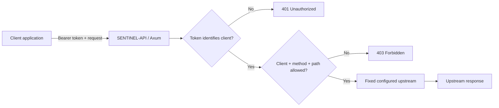

# SENTINEL-API

**A Rust reverse-proxy API gateway with per-client token authentication and explicit route authorization.**

SENTINEL-API sits in front of an upstream API. Each caller presents a bearer token; the gateway resolves that token to a client identity, checks the client's configured HTTP-method/path permission, and only then forwards the request to an owner-configured upstream.

> **Status:** portfolio prototype / local demonstration. It is not production-ready and has not undergone independent security review.

## Why it exists

Vibe-coded and small SaaS applications often place API endpoints behind broad application credentials or expose endpoints without a clear per-client permission boundary. SENTINEL-API explores a simple enforcement layer where access is denied unless the client, method, and path match an explicit policy entry.

## Architecture



### Current controls

- Separate server-side tokens map to `demo-app` and `billing-app` identities.
- TOML allowlist checks the authenticated identity, exact HTTP method, and exact path.
- Unknown/missing tokens fail with `401`; authenticated but unauthorized requests fail with `403`.
- Percent-encoded paths, backslashes, repeated slashes, dot segments, and other ambiguous path forms are rejected.
- The caller cannot choose the upstream host; it is set in `gateway.toml`.
- Remote upstreams must use HTTPS; plain HTTP is accepted only for loopback development.
- Redirect following is disabled, and HTTP request/response bodies have size limits.
- Caller authorization and other arbitrary request headers are not forwarded to the upstream.
- Automated tests verify the allow/deny behavior and assert that denied requests do not increment the mock upstream's request counter.

## Requirements

- Rust stable toolchain
- Network access the first time Cargo downloads dependencies

## Local demo

The repository includes a mock API bound only to `127.0.0.1:9001` and the gateway bound to `127.0.0.1:8080`. The mock server is for local development, not for production deployment.

Set long, unique development tokens in PowerShell:

```powershell
$env:SENTINEL_DEMO_APP_TOKEN = "sentinel-demo-app-token-2026-9f4e7c2a-unique"
$env:SENTINEL_BILLING_APP_TOKEN = "sentinel-billing-app-token-2026-1a8b5d3c-unique"
cargo run
```

The code requires each token to be at least 32 bytes and unique. These example values are for local demonstration only; generate random credentials for any shared environment.

### Allowed: `demo-app` status route

```powershell
$demo = $env:SENTINEL_DEMO_APP_TOKEN
Invoke-RestMethod `
  -Uri "http://127.0.0.1:8080/proxy/v1/status" `
  -Headers @{ Authorization = "Bearer $demo" }
```

Expected response resembles:

```json
{"status":"healthy","service":"mock-api"}
```

### Denied: `demo-app` attempts billing route

```powershell
try {
  Invoke-RestMethod `
    -Uri "http://127.0.0.1:8080/proxy/v1/users" `
    -Headers @{ Authorization = "Bearer $demo" }
} catch {
  [int]$_.Exception.Response.StatusCode
}
```

Expected: `403`. The gateway should log a `[DENY]` entry; the mock upstream should not receive the denied request.

## Verification

Run these before committing changes:

```powershell
cargo fmt --all
cargo check
cargo test
cargo clippy --all-targets -- -D warnings
```

The integration-style test starts a gateway and a counting upstream on ephemeral loopback ports. It checks valid access, cross-client isolation, disallowed methods, missing/invalid tokens, unknown routes, encoded path rejection, and the upstream hit count. Additional unit tests cover path and upstream URL validation.

## Policy example

`policy.toml` contains exact permissions:

```toml
[[permissions]]
client = "demo-app"
path = "/v1/status"
method = "GET"

[[permissions]]
client = "billing-app"
path = "/v1/users"
method = "GET"
```

A valid token alone is insufficient. A request must also match one of the authenticated client's entries.

## Security model and limitations

**Trusted inputs:** `gateway.toml`, `policy.toml`, deployment environment, and the upstream server are administrator-controlled. Protect configuration changes as privileged operations.

**Not yet implemented:** token rotation/revocation without restart, a secure token-provisioning interface, persistent audit storage, rate limiting, per-client quotas, metrics/tracing, distributed policy management, TLS termination at the gateway, graceful shutdown, container hardening, and comprehensive fuzz/property testing.

The current policy authorizes on method and path, not query-parameter values. Query strings are passed upstream unchanged; applications whose authorization depends on query parameters need additional policy rules. The example also runs its mock upstream inside the same binary for local convenience. Do not expose this configuration to the public internet or describe the project as production-ready.

A further deployment requirement is network isolation: if clients can call the upstream directly, they can bypass the gateway. Production upstreams must be private/restricted so application clients reach them only through the intended enforcement point.

## Portfolio summary

> Built SENTINEL-API, a Rust/Axum reverse-proxy gateway that authenticates client applications using server-side bearer tokens and enforces exact per-client HTTP method/path policies before forwarding requests. Added fail-closed authorization, path ambiguity checks, owner-configured upstream routing, timeout/body-size limits, and automated tests that verify denied requests do not reach the upstream.


